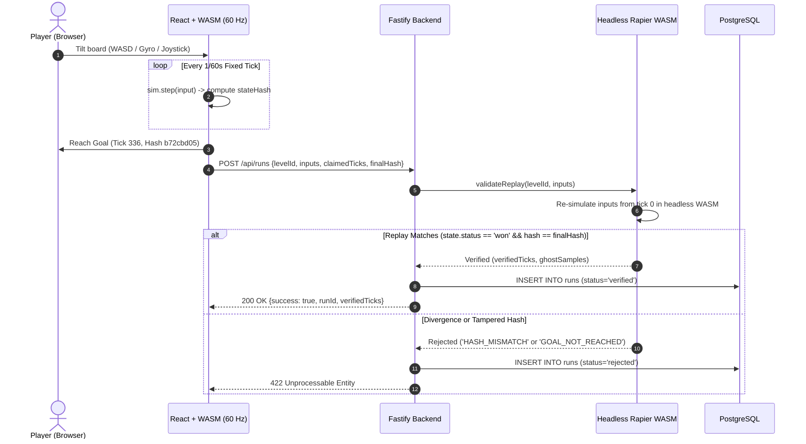

# Ghostroll 🌀

> Daily 3D marble time-trial platformer built with **bit-level deterministic WebAssembly physics**, asynchronous ghost racing, **authoritative server-side replay validation**, and procedural daily courses.

[](https://github.com/your-username/ghostroll/actions)
[](LICENSE)
[](https://rapier.rs)
[](https://coolify.io)

---

## 1. Technical Highlights & Core Architecture

1. **Bit-Level Cross-Engine Physics Determinism**:
   - Uses `@dimforge/rapier3d-deterministic-compat` with a strict fixed $60\text{ Hz}$ timestep ($dt = 1/60\text{ s}$).
   - **Trigonometry Invariant**: Gravitational tilt vectors are computed **without** `Math.sin` / `Math.cos` (whose IEEE-754 approximations diverge across V8, SpiderMonkey, and JavaScriptCore). All formulas strictly rely on fundamental operations (`+`, `-`, `*`, `/`, `Math.sqrt`).
   - Quantized 64-bit float FNV-1a hashing guarantees identical tick-by-tick state hashes across browser engines and headless Node.js servers.

2. **Authoritative Server Replay Verification Pipeline**:
   - The browser never submits final times or scores. It sends integer-quantized input frames $[-127, 127]$ (`POST /api/runs`).
   - The Fastify backend re-simulates the entire run from tick 0 to goal in headless WebAssembly.
   - Any replay divergence, tampered state hash, or impossible time is rejected with **HTTP 422**. Verified runs are persisted to PostgreSQL and indexed for the global leaderboard.

3. **Asynchronous Ghost Racing**:
   - Top runs extract downsampled $20\text{ Hz}$ trajectory vectors.
   - Competitors race against the World Record ghost or their personal best in real-time, rendered with holographic shaders and dynamic ring rotation.

4. **Procedural Daily Tracks & Seeded PRNG**:
   - Mulberry32 seeded 32-bit generator (`daily-YYYY-MM-DD`).
   - Solvable track generator assembling straightaways, ramps, bridges, corner bends, and bounce pads with procedural HSL color palettes.
   - Archive selector to race on any of the past 7 days' courses.

5. **Mobile Gyroscope Controls & iOS Permission API**:
   - Native `DeviceOrientationEvent` tilt control with neutral angle calibration ($\approx 45^\circ$ reclined reading angle) and configurable deadzone ($\pm 1.5^\circ$).
   - iOS 13+ permission request integration and virtual joystick fallback.

6. **Zero-Friction Cross-Device Sync**:
   - Instant guest provisioning via signed HTTP-only cookies (`gr_token`).
   - 6-character alphanumeric sync codes (`POST /api/me/sync-code` & `POST /api/me/claim-code`) to transfer sessions between desktop and mobile without external third-party OAuth lock-in.

7. **Bilingual i18n & Web Audio Synthesizer**:
   - Complete English 🇬🇧 and French 🇫🇷 translations.
   - Zero-asset synthesized Web Audio API sound effects (marble rolling velocity hum, resonant bounce chime, harmonic victory fanfare, fall slide).

---

## 2. Replay Verification Flow



---

## 3. Monorepo Organization

```
ghostroll/
├── packages/
│   ├── sim/          # 100% pure TypeScript deterministic physics engine
│   │   ├── src/      # Rapier3D compat, Mulberry32 PRNG, procedural track assembler
│   │   └── test/     # Vitest golden replay and cross-engine invariant tests
│   └── shared/       # Shared types, Zod schemas, RLE replay codec, share cards
└── apps/
    ├── server/       # Fastify backend, Drizzle ORM, headless verification worker
    └── web/          # React 19, React Three Fiber, Drei, Tailwind CSS v4, Web Audio
```

---

## 4. Getting Started

### Prerequisites

- Node.js $\ge 22$
- pnpm $\ge 10$

### Local Development

```bash
# 1. Install dependencies
pnpm install

# 2. Run unit & replay verification tests (Vitest)
pnpm test

# 3. Build all packages
pnpm build

# 4. Start backend server (port 3001)
pnpm dev:server

# 5. Start web dev server (port 5173 with proxy to 3001)
pnpm dev
```

Visit [http://localhost:5173](http://localhost:5173).

---

## 5. Testing & Verification Suites

```bash
# Run Vitest test suites (sim engine, level generator, server verification API)
pnpm test

# Run cross-browser Playwright e2e tests (Chromium, Firefox)
pnpm test:e2e
```

The Playwright suite verifies:
1. Browser execution of golden replay bit-for-bit identical to Node.js reference hash (`b72cbd05`).
2. Server verification and real-time global leaderboard indexing.
3. Procedural daily track rotation and course selector.
4. Profile editing, device sync code generation, and French localization.

---

## 6. Deployment with Coolify (OVH VPS)

Ghostroll is configured for zero-downtime deployment with **Coolify** using Docker Compose:

```bash
# Production container build & run locally
docker compose up --build -d
```

- **Nginx Web Container** (`apps/web/Dockerfile`): Serves optimized static assets and proxies `/api` to the backend.
- **Fastify Backend** (`apps/server/Dockerfile`): Headless Node 22 runner executing replay validation.
- **PostgreSQL 16**: Persistent database for user identities, verified runs, and ghosts.

For the step-by-step setup guide on your OVH VPS, refer to [DEPLOYMENT.md](file:///home/korentingeorget/Documents/antigravity/magical-salk/DEPLOYMENT.md).

---

## 7. Controls & Keyboard Shortcuts

| Input | Action |
|---|---|
| `▲ ▼ ◄ ►` / `WASD` / `ZQSD` | Tilt board along X and Z axes |
| `R` | Quick restart run |
| **Touch Joystick** | Floating on-screen joystick on mobile devices |
| **Gyroscope Mode** | Tilt your physical smartphone to roll the marble |

---

## 8. License

MIT © Korentin Georget
